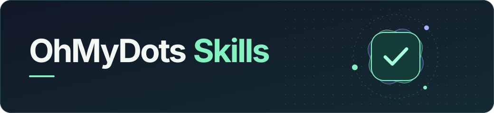

<h1 align="center">
  
</h1>

<p align="center">
  Reusable skills for AI agents that run tasks and verify their results.
</p>

<p align="center">
  <a href="https://github.com/omdots/oh-my-dots-skills/stargazers"></a>
  <a href="https://github.com/omdots/oh-my-dots-skills/actions/workflows/checks.yml"></a>
  <a href="LICENSE"></a>
  <a href="https://agentskills.io/specification"></a>
</p>

<p align="center">
  <a href="#install">Install</a> · <a href="#skills">Skills</a> · <a href="#contributing">Contributing</a>
</p>

## Install

```sh
npx skills add omdots/oh-my-dots-skills --skill verify-agent-run
```

Select your agent when prompted. For a manual install, copy the [skill folder](skills/verify-agent-run) into a skills directory your agent reads.

Then ask your agent to apply it to a specific run.

> Use `verify-agent-run` to check that the deployment is serving the requested commit. Link the deployment and report what you verified on the live endpoint.

## Skills

| Skill | Use it when |
| --- | --- |
| [`verify-agent-run`](skills/verify-agent-run/SKILL.md) | A run reports completion and you want to verify the outcome against the actual file, API state, or deployed revision. |

## Contributing

Propose a skill with a concrete task it helps an agent perform. Add its instructions in `skills/<name>/SKILL.md` and include a short example in your pull request. Use the [Agent Skills reference validator](https://agentskills.io/specification#validation) to check the skill before submitting it.

```sh
skills-ref validate skills/verify-agent-run
```

If a skill saved you a manual check, [star the repository](https://github.com/omdots/oh-my-dots-skills) to find it again.

## License

[MIT](LICENSE)
